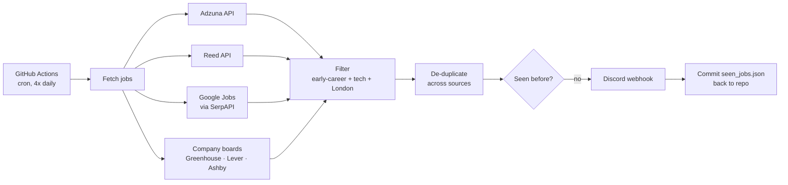

# London Tech Jobs Bot 🎓

[](../../actions/workflows/scan.yml)
[](../../actions/workflows/tests.yml)

A Python bot that searches for **tech internships, graduate schemes and junior roles in London** several times a day and sends any new ones to a Discord channel.

I built it to automate my own final-year job search. It runs for free on **GitHub Actions** with no server needed.

## How it works



1. **Collect**: pulls listings from job aggregator APIs and from the public job-board APIs of 25+ London tech employers (Monzo, Stripe, Palantir, Databricks, Spotify, Wayve…).
2. **Filter**: keeps a job only if its title has an early-career term (*graduate, intern, junior, 2027…*) **and** a tech term (*software, data, ML, cyber, cloud…*), and no excluded term (*senior, lead, placement…*). Matching uses word boundaries, so `"ai"` doesn't match *"maintenance"*.
3. **De-duplicate**: the same role often appears on several sites, so jobs are keyed on normalised `company + title`.
4. **Notify**: new jobs are posted to Discord as embeds (batched to respect Discord's rate limits).
5. **Remember**: GitHub Actions runs are stateless, so the list of seen jobs is stored in `data/seen_jobs.json` and committed back to the repo after each run. Entries older than 60 days are pruned.

### Why APIs and not scraping LinkedIn/Indeed?
LinkedIn's and Indeed's terms of service ban scraping, and they actively block bots. This project only uses official APIs and public job-board endpoints. That makes it reliable, allowed by every site it reads, and free of fragile HTML parsing.

## Tech stack
Python 3.12 · `requests` · PyYAML · pytest · Ruff · GitHub Actions (cron + CI) · Discord webhooks

## Project structure
```
jobbot/
├── main.py            # orchestration: fetch → filter → dedupe → notify → save
├── filters.py         # keyword/location matching + de-duplication
├── storage.py         # seen-jobs JSON store with pruning
├── notifier.py        # Discord webhook client (batching, 429 retry)
├── models.py          # Job dataclass
└── sources/           # one module per job source, each with a pure parse function
config.yaml            # keywords, companies, queries – tweak without touching code
tests/                 # unit tests for filters, storage, parsers
.github/workflows/     # scheduled scan + CI
```

## Setup

### 1. Get API keys (all free)
| Secret | Where | Required? |
|---|---|---|
| `DISCORD_WEBHOOK_URL` | Discord → Server Settings → Integrations → Webhooks → New Webhook → Copy URL | ✅ |
| `ADZUNA_APP_ID`, `ADZUNA_APP_KEY` | [developer.adzuna.com](https://developer.adzuna.com/) | optional |
| `REED_API_KEY` | [reed.co.uk/developers/jobseeker](https://www.reed.co.uk/developers/jobseeker) | optional |
| `SERPAPI_KEY` | [serpapi.com](https://serpapi.com/) (100 free searches/month) | optional |

The company job boards need no keys. Any source without a key is skipped.

### 2. Run on GitHub Actions
1. Fork or clone this repo.
2. **Settings → Secrets and variables → Actions → New repository secret**: add the secrets above.
3. **Actions** tab → *Job scan* → **Run workflow** to test it straight away.

After that it runs automatically at 07:00, 12:00, 17:00 and 21:00 UTC.

### 3. Run locally
```bash
python -m venv .venv && source .venv/bin/activate
pip install -r requirements.txt -r requirements-dev.txt
cp .env.example .env          # then fill in your keys
python -m jobbot --dry-run    # print matches without sending anything
python -m jobbot              # send to Discord
pytest                        # run tests
```

## Customising
Everything is in [`config.yaml`](config.yaml):
- **Keywords**: add or remove early-career, tech and excluded terms.
- **Companies**: add any company that uses Greenhouse, Lever or Ashby. The board name is in their careers URL, e.g. `job-boards.greenhouse.io/`**`monzo`**.
- **Queries**: change the search terms sent to Adzuna, Reed and Google Jobs.

## Ideas for future work
- Web dashboard to browse jobs and track applications
- Extract application deadlines and send reminders
- Score jobs against a CV with an LLM
